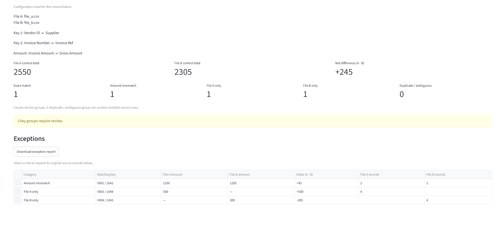

# TallyDiff

**TallyDiff v0.7.0** compares two structured financial exports locally
and explains which matching key groups account for their difference. Pair key columns, such as
vendor and invoice number, then compare unique records or explicitly aggregate
all rows sharing each key, or review bounded one-to-many correspondence.
Optional normalization handles known differences in
key representation while preserving every original source row as evidence.
Optional secondary fields compare additional evidence after keys are matched.

- **CSV and XLSX inputs**, including CSV ↔ XLSX in either direction. Select one
  worksheet per workbook; multiple worksheets require an explicit choice.
- **Three reconciliation modes**: **Unique records** keeps duplicate keys ambiguous;
  **Group by matching key** compares key totals without inferring individual
  row correspondence; **Bounded one-to-many** searches exact physical-row subsets
  under a fixed policy and requires review of every accepted inference.
- **Absolute amount tolerance**, defaulting to zero. Accepted nonzero differences
  keep their primary **Within tolerance** category. Differences without a secondary
  mismatch are accepted in a separate review table.
- **Optional ordered secondary comparisons** with asymmetric File A ↔ File B
  column names. Exact original-evidence differences require review, including
  groups whose financial delta is zero.
- **Opt-in normalization per key component**: Unicode casefolding, whitespace
  collapse, punctuation removal, and ASCII leading-zero removal. Every rule starts
  off; same-file normalization collisions block all three reconciliation modes.
- **Reusable mapping profiles** for ordered key pairs, amount columns, tolerance,
  mode, normalization, secondary mappings, and the bounded policy identifier.
  Current downloads use schema version 5; valid versions 1–4 migrate explicitly.
- **Exact Decimal arithmetic and original evidence**. XLSX numeric cells first
  convert through decimal text; Excel display formatting is not reconstructed.
  Formulas and Excel errors in selected key, amount, or secondary fields block ingestion.
- **Analyst review workflow** with dispositions, optional plain-text notes,
  progress counts, and explicitly saved resumable review sessions. Key search,
  category, minimum-delta, secondary-mismatch, and disposition filters support review.
- **Complete exception CSV export**, independent of review filters, with every
  review-required group and its complete source references. Accepted variance
  remains outside this report.

Equal totals alone never imply a reconciliation. TallyDiff reports differences;
it does not decide which source is authoritative. See [known limitations](#known-limitations)
and [XLSX cell policies](#xlsx-worksheet-and-cell-policies) before preparing exports.

TallyDiff v0.7.0 adds analyst review while retaining bounded correspondence and
mapping-profile schema v5. Review-session JSON uses its independent schema v1.



The screenshot shows the synthetic +245 CSV example in an earlier interface.
The same zero-comparison Unique records result remains valid. This historical
image predates secondary-comparison controls, normalization, reconciliation modes,
review controls, tolerance, mapping profiles, and XLSX worksheet selection; it
does not show the full current workflow.

## Quick start

Requirements: Python **3.12+** and [uv](https://docs.astral.sh/uv/).
Clone this repository, then run these commands from its root:

```bash
uv sync --locked
uv run streamlit run src/tallydiff/app.py
```

Open <http://127.0.0.1:8501>. The tracked `.streamlit/config.toml` binds the server
to the local machine and disables Streamlit usage telemetry. TallyDiff does not
send uploaded data to external services, cache it globally, or save it to disk.
Files and results are held in the local session; downloaded reports are saved
where you choose. Installing dependencies requires network access initially.

## Sample workflow

The files in `sample_data/` contain only synthetic records.

1. Upload `sample_data/file_a.csv` as **File A** and `sample_data/file_b.csv` as
   **File B**. The app displays each filename and validated column names.
2. Choose the mappings below. Use **+ Add key field** for the second key pair.
   Every selector starts empty; the app does not infer mappings.

   | Selection | File A | File B |
   | --- | --- | --- |
   | Key field 1 | Vendor ID | Supplier |
   | Key field 2 | Invoice Number | Invoice Ref |
   | Amount | Invoice Amount | Gross Amount |

3. Leave **Reconciliation mode** at **Unique records** and **Amount tolerance** at
   its default `0`, leave secondary comparisons unconfigured, then click
   **Run reconciliation**.
   Expect File A total **2550**, File B total **2305**, and net difference **+245**. The four key groups are:

   | Matching key | Category | Delta (A - B) |
   | --- | --- | --- |
   | V001 / 1042 | Amount mismatch | +45 |
   | V002 / 1043 | Exact match | 0 |
   | V003 / 1044 | File A only | +500 |
   | V004 / 1045 | File B only | -300 |

4. Select **V001 / 1042** in the exception table. Both evidence panels show
   source record **2**, including the original amounts **1250** and **1205**.
   Set **Analyst disposition** to **Needs follow-up** and optionally enter an
   **Analyst note**. Leave the note field or commit its widget to save the edit.
5. Click **Download exception report**. The CSV contains exactly the three
   exception groups above, with blank amounts for the missing sides.
6. Click **Prepare review downloads**, then **Download reviewed exception report**
   or **Download review session**. To resume later, rerun the equivalent
   reconciliation, upload the JSON under **Review session JSON**, and click
   **Apply review session**.

The pair order defines the composite key. Incomplete mappings or repeated key
column selections disable reconciliation. A changed file or worksheet resets
mappings, including secondary selections; any file, worksheet, mapping, mode,
tolerance, or normalization change clears the result and download until you run
again. Review controls and evidence selection preserve the current result.

## Reconciliation modes

**Unique records** is the default. Exactly one source row on each side is eligible
for an exact, tolerated, or mismatched comparison. More than one row on either
side makes the entire matching-key group **Duplicate / ambiguous**, even when totals
agree, offset to zero, or the other side is absent. All rows remain visible.

**Group by matching key** totals every row sharing the explicitly mapped composite
key independently on each side, then compares those totals. For example, File A
rows of `100` and `200` versus a File B row of `300` form an exact group. This
supports one-to-many, many-to-one, and many-to-many key groups without guessing
row pairs. Presence takes precedence over net amount: a zero-net group with no
File B rows remains **File A only**, and vice versa.

**Key-total agreement does not establish individual-row correspondence.** Grouped
mode performs no subset-sum search, allocation, or inferred many-to-many matching.
The result discloses its mode and keeps this disclaimer visible. Its **Grouped
exact key totals** table offers selectable evidence only for exact findings with
multiple source rows on at least one side and no secondary mismatch. The overall
**Exact match** count still includes one-to-one exact findings. All counts
represent key groups, not rows.

**Bounded one-to-many** analyzes the entire matching-key group only when one side
has exactly one row, the **sole anchor**, and the other has multiple candidate
rows. Either File A or File B may be the anchor. It searches nonempty subsets
with **exact Decimal equality**, preserving physical row identity: equal-valued
rows are separate choices. Singleton solutions compete with multirow solutions;
a unique singleton is reported as **SINGLETON_ONLY** and is never promoted to an
accepted one-to-many inference. Ordinary one-versus-one groups retain the usual
exact/tolerance/mismatch rules.

An accepted solution must be unique and contain at least two candidate rows.
All parent rows remain evidence. A full subset has primary **Exact match**;
any residual row makes the parent **Amount mismatch**, even if the residual amount
falls within tolerance. **Every accepted inference requires
review**, including exact, signed-credit and zero-anchor solutions. Unresolved
duplicates stay **Duplicate / ambiguous** with an explicit analysis status.
Amount consistency does not establish accounting authority or business validity.

| File A | File B | Bounded outcome |
| --- | --- | --- |
| `300` | `100, 200` | Unique full subset; Exact match; review required |
| `300` | `100, 200, 50` | Unique subset with residual `50`; Amount mismatch; review required |
| `300` | `100, 200, 150, 150` | Two exact physical subsets; ambiguous; no accepted allocation |
| `300` | `300, 100, 200` | Singleton rival competes with a pair; ambiguous |
| `300, 50` | `100, 200` | Both sides have multiple rows; not eligible |
| `0` | `150, -150` | Unique signed pair; Exact match; review required |
| `0` | `0, 0` | Two physical singleton rivals; ambiguous |

The fixed **exact_unique_v1** policy permits **12 candidates** (at most **4,095**
nonempty combinations per key), **1,000,000 planned combinations per run**, and
**two retained ambiguity witnesses**. Groups are processed in sorted canonical-key
order. Each eligible search reserves its entire planned cost before examination;
early ambiguity still charges that full reservation. The first eligible group
whose cost cannot fit records **RUN_BUDGET_EXHAUSTED**; all later searchable
groups remain unsearched, even if individually cheaper. Structural exclusions
and the **CANDIDATE_ROW_LIMIT** keep their own reason and reserve no work.
Bounded or unsearched results preserve every row and explicitly disclose their
limit; they do not prove that no exact subset exists. Two witnesses establish
ambiguity; singleton-only analysis retains its sole one-row witness. Witnesses
are never accepted allocations. Secondary fields cannot choose,
rank or disambiguate monetary subsets.

Normalization and collision safety preflight apply before any mode matches
or groups rows. Distinct same-file original keys cannot be combined by normalization.

## Key normalization

Each ordered key pair has its own **Key N normalization** controls. All four rules
start **off**. A selected rule applies identically to that component in File A
and File B; other components keep their own settings. With every rule off,
matching retains the existing input conversion and surrounding-whitespace trim,
with case, internal whitespace, punctuation, and leading zeroes significant.

Enabled rules always run in this fixed order, independent of checkbox click order:

1. **Ignore letter case** uses Unicode `str.casefold()`: `Straße` and `STRASSE` become
   `strasse`. It does not strip accents or transliterate text.
2. **Collapse whitespace** trims surrounding Unicode whitespace and replaces
   each internal run of Unicode whitespace with one ASCII space.
3. **Ignore punctuation** removes characters whose Unicode category starts
   with `P`. Symbols such as currency signs, mathematical symbols, and emoji remain.
4. **Ignore leading zeros** applies only to a nonempty component containing
   ASCII digits `0`–`9` exclusively. It removes leading zeroes and maps all-zero
   strings to `0`. It does not parse integers, floats, or Decimals.

For example, enabling punctuation removal and leading-zero removal changes
`-001` to `1`: punctuation is removed first. Non-ASCII digits, decimal points
without punctuation removal, signs without punctuation removal, and mixed
letters/digits do not qualify for the digits-only rule.

With all four rules enabled on the vendor component and only leading-zero
removal on the invoice component:

| Source | Original vendor | Original invoice | Matching key |
| --- | --- | --- | --- |
| File A | `Vendor-000123<TAB>West` | `000001042` | `vendor000123 west / 1042` |
| File B | `VENDOR000123   WEST` | `1042` | `vendor000123 west / 1042` |

Here `<TAB>` denotes a tab in the source text. Original cell/field values and
`SourceRecord.key` remain unchanged; findings use the resulting matching key.
A component that becomes blank blocks the run with file, source row, component,
and original-value context.

**Distinct full original keys within the same file must never collapse to one
matching key.** Such a normalization collision blocks **both** modes before
classification, even when the amounts agree. The collision diagnostic shows the
normalized key, distinct full original keys, every affected source row, and its
original evidence. There is no override. Repeated rows with the same full original
key remain ordinary duplicates: ambiguous in Unique records, or totaled in
Group by matching key. Different keys converging only across File A and File B
are allowed. A shared normalized component is not a collision when the complete
composite keys remain distinct.

Completed results disclose the exact rules used per component, including exact
components. Matching-key tables, search, sorting, and exports use the completed
matching keys; source evidence retains original values. Changing any rule clears
the result and download until the next run. An all-false configuration is treated
as `None` by app/profile configuration, preserving exact-default behavior.

## Secondary comparison fields

Secondary fields are optional and start with **zero comparisons**. After selecting
matching keys, normalization, and amount columns, use **+ Add comparison field**
to add ordered File A ↔ File B pairs. Names may differ, such as **Department** ↔
**Cost Center**, **Currency** ↔ **Currency Code**, and **Posting Date** ↔
**Document Date**. Each side's secondary columns must be unique and separate from
its primary amount column. A matching-key column may also be a secondary field.
Incomplete or conflicting mappings block the run and profile download. Removing
a pair deletes its selections; uploads and worksheet changes reset all mappings.

Comparison is exact on preserved deterministic **original evidence strings**,
without secondary normalization, fuzzy matching, numeric/date equivalence, case
conversion, or whitespace trimming. `100` differs from `100.00`, and composed and
decomposed Unicode differ. Blank evidence is a present `""` value. XLSX comparisons
use the existing cell-value conversion, including numeric decimal and ISO date
text; Excel visual formatting does not supply missing characters or zeroes.

- **Unique records:** evaluate equality only with exactly one row on each side.
  One-sided findings and duplicate/ambiguous groups report **NOT_COMPARABLE**,
  retaining their observed distinct values. This status adds no independent review
  requirement and does not claim a match; their primary category still requires review.
- **Group by matching key:** compare each field's **independent distinct-value set**
  across every source row. `Sales` versus `Sales, Sales` matches; `Sales, Sales`
  versus `Sales, Marketing` differs. Occurrence counts are ignored. Credits, zero
  lines, offsets, and blank values all contribute evidence. Both sides must be
  present; one-sided groups report **NOT_COMPARABLE** in this mode too.
- **Bounded one-to-many:** ordinary one-versus-one comparisons use normal exact
  secondary equality. Every analyzed duplicate-shaped group reports
  **NOT_COMPARABLE** for every configured field, even when whole-key distinct
  sets agree or a monetary inference is accepted. Sets retain all parent rows,
  including residuals. Secondary equality is not evidence of row correspondence.

**Grouped secondary equality establishes no row pairing, cross-field association,
secondary subtotal, or amount allocation.** If Department sets are both
`{Sales, Marketing}` and Currency sets are both `{USD, EUR}`, both comparisons
match even when departments and currencies are associated differently across
individual rows. It does not validate Department/Currency combinations.

Any **MISMATCH** requires review while leaving primary amount/presence categories
and every financial delta unchanged. For example:

| Evidence / result | File A / outcome | File B |
| --- | --- | --- |
| Amount | 1000 | 1000 |
| Department ↔ Cost Center | Sales | Marketing |
| Primary category | Exact match | |
| Financial delta (A - B) | 0 | |
| Review | Exception because the secondary field differs | |

A **Within tolerance** finding with a secondary mismatch is also an exception;
it contributes no accepted tolerated variance. Primary category counts retain
amount/presence meaning. **Secondary field differences** separately counts key
groups with at least one mismatch, excluding NOT_COMPARABLE-only groups.

Results disclose the ordered mappings and mode-specific comparison meaning.
Selecting a finding displays every comparison's field names, sorted distinct
values as JSON arrays, and status above all original source rows. `[]` means no
observed values; `[""]` means a present blank. Original evidence remains traceable.
If punctuation normalization joins keys `ACME-01` and `ACME01`, selecting those
identifier columns as secondary evidence still produces a mismatch. Matching-key
normalization never rewrites secondary evidence.

## Absolute amount tolerance

**Amount tolerance** accepts ordinary monetary text in the same units as the
selected amount columns. It defaults to `0`, requiring exact amount equality.
Negative, blank, malformed, and non-finite values block reconciliation. The
existing monetary grammar is used directly to construct a Decimal; no float
conversion or rounding occurs, and more than two decimal places are supported.

Tolerance applies to eligible keys present on both sides: single records in
Unique records mode, or complete key totals in Group by matching key mode. Exact
equality remains **Exact match**. A nonzero difference is **Within tolerance**
when `abs(A - B) <= tolerance` (inclusive); larger differences are **Amount
mismatch**. At tolerance `0.01`, `100.00` versus `100.01` is within tolerance with
a true delta of `-0.01`; `100.00` versus `100.02` remains an amount mismatch.
One-sided groups always require review, including zero-net grouped keys. Duplicate
/ ambiguous groups in Unique records mode remain exceptions regardless of tolerance.
In Bounded one-to-many, tolerance applies only to ordinary one-versus-one groups;
subset equality is exact and residual parents remain mismatches regardless of tolerance.

Within-tolerance findings **without a secondary mismatch** are accepted variances,
excluded from exceptions and their CSV report. A secondary mismatch keeps the
Within tolerance primary category but makes the group review-required. The
summary shows the tolerance used and the
Within tolerance group count. A separate **Within tolerance** table retains both
amounts, the actual delta, and selectable original source evidence. Its **Net
accepted variance (A - B)** is a signed sum: opposing deltas can cancel, while
the count and individual rows still expose every accepted difference.

With only exact matches and accepted differences, the app says **Reconciled
within configured tolerance**. The control totals and net difference always
include all true deltas; tolerance never zeroes, rounds, or hides arithmetic.

## Portable mapping profiles

For recurring exports with the same logical columns, save the current valid
configuration with **Download mapping profile**. The download is available once
the ordered key pairs, amount columns, mode, tolerance, normalization, and any
secondary mappings are valid; you do not need to run reconciliation first. The default filename is
`tallydiff_profile.json`, and you may rename it outside TallyDiff.

A profile remembers ordered File A ↔ File B key pairs, both amount columns,
reconciliation mode, exact Decimal tolerance (including trailing zeroes such as
`0.0100`), the four normalization flags for each key pair, and ordered secondary
comparison mappings with exact directional column names, plus `one_to_many_policy`:
`"exact_unique_v1"` for bounded mode and `null` for the two legacy modes.
Limits and semantic switches are fixed by the application, not configurable in profiles.
It contains column names and configuration only: no source rows or values,
filenames or hashes, worksheet names, financial totals, findings, collision
evidence, timestamps, or machine-specific paths. Profiles stay local; TallyDiff
uses no external service, profile directory, database, account, browser storage,
or automatic filesystem writes. Saving is an explicit download to a location
you choose.

To reuse a profile:

1. Upload the new File A and File B exports (CSV or XLSX). Select worksheets
   for workbooks before applying a profile.
2. Under **Mapping profile**, upload the saved JSON file. Selecting a file alone
   does not change the current configuration.
3. Click **Apply profile**. TallyDiff validates the entire profile and every
   required column on its configured side before changing any setting.
4. Check the restored key pairs, all normalization checkboxes, amount columns,
   mode, tolerance, and ordered secondary pairs, then click **Run reconciliation**.
   Applying a valid profile
   clears any prior result and exception download, even if its configuration is identical.
5. Edit any populated control normally if needed, and download a new profile
   when the new configuration is valid. Profiles never lock the controls.

Column names must match exactly on the correct side, including case and
whitespace. Extra columns and changed filenames or header order are allowed.
Profiles are format-agnostic: they contain no input type or worksheet name and
work with any CSV/XLSX combination exposing the required columns.
Missing or renamed required columns produce an error naming the unavailable
columns; nothing is partially applied or guessed. A rejected profile leaves the
current configuration and any completed result intact. Update mappings manually
when schemas change, then save a new profile.

Current profiles use UTF-8 JSON with schema version **5**. For an export with
these columns, a profile can include:

```json
{
  "format": "tallydiff-mapping-profile",
  "version": 5,
  "key_pairs": [
    {"file_a": "Vendor ID", "file_b": "Supplier"},
    {"file_a": "Invoice Number", "file_b": "Invoice Ref"}
  ],
  "amount_columns": {
    "file_a": "Amount",
    "file_b": "Gross Amount"
  },
  "amount_tolerance": "0.0100",
  "reconciliation_mode": "grouped_by_key",
  "key_normalization": [
    {
      "casefold": true,
      "collapse_whitespace": true,
      "remove_punctuation": true,
      "strip_leading_zeros": false
    },
    {
      "casefold": false,
      "collapse_whitespace": false,
      "remove_punctuation": false,
      "strip_leading_zeros": true
    }
  ],
  "comparison_fields": [
    {"file_a": "Department", "file_b": "Cost Center"},
    {"file_a": "Currency", "file_b": "Currency Code"},
    {"file_a": "Posting Date", "file_b": "Document Date"}
  ],
  "one_to_many_policy": null
}
```

| Profile schema | Loaded reconciliation mode | Loaded normalization | Secondary comparisons |
| --- | --- | --- | --- |
| Version 1 | Unique records | All rules off | None |
| Version 2 | Stored mode | All rules off | None |
| Version 3 | Stored mode | Stored ordered per-component rules | None |
| Version 4 | Stored mode | Stored ordered per-component rules | Stored ordered pairs |
| Version 5 | Stored mode, including bounded | Stored ordered per-component rules | Stored ordered pairs |

Current downloads always use version 5, including `comparison_fields: []` when
none are configured. Versions 1–3 explicitly clear existing secondary selections.
Versions 1–4 load with no bounded policy and cannot select bounded mode; version 4
retains comparisons. Version 5 requires the exact policy ID for bounded mode and
`null` for legacy modes; unknown IDs, policy objects or custom limits are rejected.
The `key_normalization` array has exactly
one object per ordered key pair, each containing exactly the four documented
boolean fields. All-false rules canonicalize to `None` on load and restore every
checkbox to off. Version 1 has neither mode nor normalization fields; version 2
has mode but no normalization field. Current modes are `"unique"`,
`"grouped_by_key"`, or `"bounded_one_to_many"`.
Tolerance is a JSON string parsed directly with the monetary grammar; JSON
numeric tolerances are rejected. Invalid JSON, duplicate or unknown fields,
unsupported formats or versions, non-boolean flags, component-count mismatches,
blank or repeated key selections, invalid amount names, incomplete/repeated
secondary selections, same-side amount/secondary overlap, and invalid or negative
tolerance are rejected with a concise message. Key/secondary overlap is allowed.

Package version **0.6.0** and profile schema version **5** are separate versions.

## Supported inputs

- Each input may independently be comma-delimited UTF-8 CSV (optional BOM) or
  `.xlsx`: CSV ↔ CSV, CSV ↔ XLSX, XLSX ↔ CSV, and XLSX ↔ XLSX are supported.
  Header names and selections are exact. Header-only inputs are valid.
- One or more explicitly paired key columns in the same logical order, and one
  amount column per file, with zero or more ordered secondary pairs. By default,
  matching trims surrounding key whitespace
  only; optional per-component rules are described under [key normalization](#key-normalization).
- U.S.-style amounts such as `1200.00`, `1,200.00`, `$1,200.00`, `-1200.00`, and
  `(1,200.00)`. Quote CSV fields containing commas. All decimal places are retained.
- Invalid encoding, malformed CSV, missing fields, blank keys, invalid headers,
  or invalid amounts block the run with file/record/column context where available.
  Header discovery checks only the header; reconciliation validates every record.

See the [monetary grammar](#monetary-text-grammar) for the full accepted syntax.

## XLSX worksheet and cell policies

Upload an ordinary, unencrypted **.xlsx** workbook with text column names in
**worksheet row 1** and structured data underneath. A workbook with one ordinary
worksheet selects it automatically. With multiple worksheets, select one explicitly;
TallyDiff never guesses by name or uses Excel's active-sheet setting. Names are
shown exactly, in workbook order, including hidden/very-hidden worksheets.
Chartsheets are not reconciliation worksheets. Only the selected sheet is ingested.
Changing a worksheet clears mappings, results, and the exception download.

Headers must be nonblank, unique text, matched exactly. Numeric/date/formula
headers, merged-header interpretation, multiple header rows, and arbitrary layouts
are unsupported. Empty cells after the last header name are unused columns;
any populated data beyond the named columns blocks ingestion. Trailing wholly
empty rows, including format-only rows, are ignored. A wholly blank row inside
the populated data region blocks ingestion with its row number. Partially populated
rows remain subject to required-key and amount validation; they are never dropped.

**Amounts:** numeric cells exposed by openpyxl as int/float must be finite and
convert through Python's shortest deterministic decimal text, using
`Decimal(str(value))`: numeric `100` → `100`, `100.01` → `100.01`, and
`-42.5` → `-42.5`. TallyDiff preserves the decimal value represented by that
openpyxl value. It does not reconstruct Excel's underlying binary representation
or recover precision already lost in the workbook. No `Decimal(float)` conversion
occurs. Text amounts use the same strict monetary grammar as CSV, including
`$1,200.00` and `(42.50)`. Blank, boolean, error, date/time, and non-finite amounts
block ingestion.

**Keys:** ingestion retains leading zeroes, case, internal whitespace, and punctuation
in text keys, trimming surrounding whitespace. Optional engine normalization acts
on matching keys afterward and never rewrites this source evidence. Finite numeric keys become
canonical decimal text without locale formatting, exponent notation, or insignificant
fractional zeroes. Numeric `123` remains `"123"`, even with a `000000` number format;
text `"000123"` remains a different key by default. Store identifiers as **text** in Excel
when leading zeroes matter. Date/datetime/time keys use stable ISO text as exposed
by openpyxl; a date-formatted serial can appear as a datetime ending in
`T00:00:00`. Keep source types consistent when matching dates across exports.
Blank, boolean, Excel error, formula, and duration keys are rejected.

**Formulas:** workbooks load read-only with `data_only=False`. A formula in any
selected key, amount, or secondary cell blocks ingestion with File A/B, worksheet,
row, and column context. Export or paste those reconciliation fields **as values** first.
TallyDiff never evaluates formulas or uses cached results. Selected secondary
Excel error cells are also rejected. Formula-looking CSV strings remain ordinary
exact evidence; XLSX formula cells must first be exported/pasted as values.
Ordinary formulas in unselected evidence columns are retained as formula text.

**Evidence:** XLSX evidence shows deterministic **source cell values**, not Excel's
visual formatting: original text, numeric decimal text, ISO date/time text,
`TRUE`/`FALSE`, formula/error text, and empty strings for blank cells. Duration
values in unrelated evidence columns use their textual duration representation.
Number formats never infer currency, add commas/currency signs, restore leading
zeroes, invent trailing zeroes, round, or quantize amounts. For example, a cell
with underlying `1234.5` and display format `$#,##0.00` retains `1234.5`.
Styles, colors, comments, and calculated formula values are not preserved.

XLSX source references use **actual worksheet row numbers**: header row 1, first
data row 2. CSV references count logical CSV records, so multiline fields do not
advance the source number. Keep the original workbook and selected sheet with
any exception report to locate its evidence.

Processing is local and in memory using openpyxl; Excel/LibreOffice are not
required. Legacy `.xls`, macro-enabled `.xlsm`, templates, encrypted workbooks,
formula calculation, table/pivot interpretation, named ranges, and reconciling
multiple sheets at once are unsupported. The exception download remains CSV;
TallyDiff does not write Excel workbooks. Schema version 5 profiles store mappings,
tolerance, mode, per-component normalization, and ordered secondary pairs independently
and the bounded policy ID independently of input format, filename, or sheet;
valid versions 1–3 load with zero comparisons and version 4 retains comparisons.
Versions 1/2 also load with normalization off.

## Correctness and traceability

| Category | Unique records | Group by matching key | Bounded one-to-many |
| --- | --- | --- | --- |
| Exact match | One row on each side with equal amounts. | Both sides present with equal key totals. | Ordinary exact pair, or unique full subset requiring review. |
| Within tolerance | One row on each side with a nonzero absolute delta at or below tolerance. | Both sides present with a nonzero absolute key-total delta at or below tolerance. | Ordinary one-versus-one only. |
| Amount mismatch | One row on each side with an absolute delta above tolerance. | Both sides present with an absolute key-total delta above tolerance. | Ordinary mismatch, or accepted subset with any residual rows. |
| File A only | One File A row and no File B row. | One or more File A rows and no File B rows, even with a zero net amount. | One File A row and no File B row. |
| File B only | One File B row and no File A row. | One or more File B rows and no File A rows, even with a zero net amount. | One File B row and no File A row. |
| Duplicate / ambiguous | More than one row on either side; all rows need review. | Not emitted: every key group is compared by presence and totals after preflight. | Any unresolved analyzed group, including ineligible, singleton-only, no-exact and bounded searches. |

In Unique records mode, duplicates take precedence over other categories, even
when amounts agree or offset to zero. Grouped mode checks presence before totals.
No mode silently discards source rows. Bounded inference is explicit and review-required.
Primary categories describe amount/presence/ambiguity independently of secondary
status. Exact and within-tolerance groups may still require secondary review.
Counts represent key groups, while the evidence panels retain every source row.
A missing side shows an em dash in the table and a blank amount in the export;
a present zero-dollar record shows its actual Decimal amount, such as `0.00`.

The engine checks both row accounting and this invariant on every run:

```text
File A control total - File B control total = sum of all finding deltas
```

The review partition also obeys this identity, checked by independent validation:

```text
Control difference = sum of exception deltas + net accepted variance
```

Monetary text is parsed directly to `Decimal`. XLSX numeric cells first convert
from openpyxl's int/float value through decimal text, as described above. All
subsequent arithmetic uses exact `Decimal`, without rounding or quantization.
Tolerance changes classification only. Findings are sorted by key, and evidence
by source record number. Cell-value evidence is preserved in immutable snapshots.
XLSX source numbers are actual worksheet rows. The CSV header is record **1**, and the first data record is **2**; a quoted multiline
field is still part of one record, so these are not necessarily physical line numbers.

## Exception review controls

The exception table supports these display-only controls:

- **Search matching keys** finds a case-insensitive substring within any key
  component of the completed matching key, which may already be normalized.
  Surrounding search whitespace is ignored; search adds no key transformations,
  fuzzy matching, or regular-expression interpretation.
- **Exception categories** always offers amount mismatch, File A only, File B only,
  and duplicate / ambiguous groups. Exact match and Within tolerance are added
  when such review-required groups exist, including accepted inference. All options start selected;
  selecting none shows no exceptions.
- **Has secondary field mismatch** appears for configured comparisons and defaults
  to off. When enabled it hides primary-only and NOT_COMPARABLE-only exceptions.
- **Minimum absolute delta** defaults to `0` and includes the boundary. Blank
  means zero. Invalid or negative input shows an error without clearing the
  completed reconciliation. Zero includes exact-amount secondary exceptions; any
  positive minimum hides their zero delta. This filter does not change amount tolerance.
- **Exception sort order** defaults to ascending matching key, with absolute delta
  options largest or smallest first. Equal absolute deltas use the key as a
  deterministic tie-breaker.
- **Review disposition** separately filters Unreviewed, Needs follow-up, and
  Review complete items. Workflow progress counts always cover all exceptions,
  independently of this filter and the financial category filters.

**Showing X of Y exception groups** distinguishes displayed and total counts. A view
with no matches leaves the completed result available. Selecting any visible row
opens structured comparison details and every original source row for that
finding, including multi-row groups. Changing a review view clears its row selection.
Exact grouped totals and accepted variances retain separate evidence tables.
Analyzed evidence also shows the parent anchor, selected subset, residual rows,
ambiguity witnesses, reason, counters and completeness, while retaining both
complete original source tables.

Review controls and evidence selection do not change configuration identity,
profiles, reconciliation metrics, control totals, or the exception download.
**Download exception report always contains all exceptions**, including those
hidden by the current search or filters.

## Analyst review workflow

Review items are exactly the completed reconciliation's **exceptions**, in all
three modes. Clean exact matches and accepted tolerance findings without a
secondary mismatch or accepted inference are outside review scope. Inferred
Exact matches and secondary-only exceptions are included, even with zero delta.
Each item starts **Unreviewed**; an analyst can mark it **Needs follow-up** or
**Review complete** and attach an optional plain-text note.

Disposition and notes never change category, delta, source evidence,
correspondence analysis, exception membership, tolerance treatment, or control
totals. **Review complete** means workflow completion, not accounting authority
or approval. Notes do not determine reconciliation truth. Progress covers the
complete exception population; the disposition filter is separate from financial
category filters.

Edits are held in local session state. Notes are saved when you leave the field
or commit its widget. Each note permits up to **16,384 UTF-8 bytes**; invalid
drafts show an error and leave the committed note unchanged. **Prepare review
downloads** captures the committed complete review state. Both downloads include
all exceptions, independently of current filters. Commit later edits and prepare
again to refresh the downloads.

The original **Download exception report** remains the deterministic
reconciliation artifact. **Download reviewed exception report** saves
`tallydiff_reviewed_exceptions.csv`, preserving the original columns and appending
**Review disposition** and **Review note**. Every nonempty note receives the
literal `Note: ` prefix in CSV; JSON retains the exact note. Existing
source-evidence cells are **not spreadsheet-sanitized**, and reviewed CSV is not
a universal spreadsheet-safety guarantee. Follow the [CSV import guidance](#exception-report).

**Download review session** saves `tallydiff_review_session.json`, format
`tallydiff-review-session`, **version 1**, with the full exception population.
To resume, rerun the equivalent reconciliation, upload that JSON, then explicitly
click **Apply review session**. Upload alone applies nothing. Apply validates the
whole document before replacing all annotations; it does not merge partial
reviews. The deterministic binding covers exact source bytes, input formats and
worksheets, configuration, and completed result evidence. Byte-identical renamed
inputs can restore after the equivalent rerun; changed source bytes,
configuration, or result evidence are rejected. Review-session documents are
limited to **64 MiB**.

There is no automatic database, cloud, browser, or disk persistence: uploaded
files and review state are not automatically written to disk or external
services. Explicit downloads go where you choose. Saved sessions contain matching
keys and analyst notes and may contain sensitive business information. The
workflow provides no timestamps, history, authentication, or multi-user approvals.

## Exception report

**Download exception report** saves `tallydiff_exceptions.csv` for the complete
reconciliation result, including exceptions hidden by review controls. There
is one row per exception key group, including zero-delta ambiguous and one-sided
groups, exact-amount secondary mismatches and every accepted inference.
Exact/within-tolerance groups are excluded only when they have no secondary
mismatch or accepted inference; the UI offers no exception
download when there are no exceptions.
When accepted variance exists, exception-report deltas alone need not equal the
control difference: add the net accepted variance shown in the UI.

The unchanged seven base columns, in order, are:
`Category`, `Matching key`, `File A amount`, `File B amount`,
`Delta (A - B)`, `File A records`, `File B records`. Matching key components use
` / `, as in the table. With normalization active, these are normalized matching
keys; the original inputs and evidence retain original keys. Amounts and signed
deltas retain the application's exact
Decimal text. Missing-side amounts are blank; a present `0.00` remains `0.00`.

Configured comparisons append `Secondary differences`, then three columns per
ordered pair: `Comparison N File A values — <A field>`,
`Comparison N File B values — <B field>`, and `Comparison N status`.
Values are exact UTF-8 JSON arrays of sorted distinct evidence strings, including
observed values for NOT_COMPARABLE findings. Status is `match`, `mismatch`, or
`not_comparable`. The secondary summary identifies only mismatching pair numbers
and names. Primary category labels and true financial deltas remain unchanged.

When any exported exception contains stored analysis, append **Correspondence
status** and **Correspondence evidence** after all secondary columns (or after
the seven base columns with zero comparisons). Ordinary rows have blank cells;
an export with no analyzed exceptions omits both columns. The status uses the
machine value, such as `unique_exact` or `bound_exceeded`. Evidence is compact,
versioned UTF-8 JSON: `schema_version: 1`, all eight policy fields, matching-key
array, status, nullable reason and sole-parent anchor, nullable accepted solution,
unassigned rows on each side, ordered ambiguity witnesses, planned/examined/reserved
counters and `search_complete`. Each physical reference has source, original
source-row ordinal, exact amount string and original key array; each solution
has its amount and rows on both sides. Two witnesses prove ambiguity; a
singleton-only witness records the sole one-row candidate. Neither is accepted
correspondence. JSON object order and complete CSV bytes are deterministic.

Each side lists **all** participating source record numbers, separated by `; `,
including every duplicate. Keep the original input files, selected worksheet
names, and the configuration shown in the UI: those references provide traceability without duplicating every
raw field in the report. The joined key is a display label, not a serialization
for reconstructing composite keys that themselves contain ` / `.

Output is comma-delimited UTF-8 CSV without a BOM, with CRLF record endings and
standard quoting for commas, quotes, and embedded newlines. The UI-independent
`export_exceptions_csv(result)` API returns bytes; a result with no exceptions
produces a header-only CSV.

**Spreadsheet safety:** matching-key text is exported as displayed, without
adding an apostrophe or tab prefix. Such prefixes would change identifiers for
downstream CSV consumers. This preserves traceability but means the report is
**not sanitized for spreadsheet formula execution**. Formula-like keys, including
values starting with `=`, `+`, `-`, or `@`, can be interpreted as formulas by a
spreadsheet; CSV quoting alone does not prevent this. Control characters and
locale-specific variants can also matter. See [OWASP's CSV injection guidance](https://community.owasp.org/attacks/CSV_Injection).

Do not open untrusted reports by double-clicking them in a spreadsheet. Use a CSV
reader, or import every column as text with formula evaluation disabled. Text
import also avoids losing leading zeroes or rounding long monetary values in the
spreadsheet. Numeric amount/delta cells are never prefixed or otherwise rewritten.

## Architecture

| Module | Responsibility |
| --- | --- |
| `_decimal.py` | Exact addition isolated from the caller's Decimal context. |
| `amounts.py` | Strict monetary text parsing directly to Decimal. |
| `models.py` | Validated source records, immutable evidence, findings and totals. |
| `engine.py` | Normalization/collision preflight, grouping, classification, ordering and integrity checks. |
| `subset_matching.py` | Fixed bounded exact physical-row subset search and stored correspondence evidence. |
| `normalization_config.py` | Immutable, stdlib-only per-component normalization configuration. |
| `normalization.py` | Deterministic transformations and structured original-key collision evidence. |
| `ingest.py` | Header discovery and atomic CSV validation with explicit mappings. |
| `xlsx.py` | Worksheet/header discovery and atomic XLSX validation into the same source records. |
| `configuration.py` | Shared ordered column mappings and manual mapping validation. |
| `profiles.py` | Validated JSON profile import/export and directional column compatibility. |
| `presentation.py` | UTF-8 decoding, configuration identity, review filtering/sorting and display strings. |
| `review.py` | Immutable analyst annotations, deterministic result binding, and validated review-session JSON. |
| `export.py` | Complete original/reviewed exception CSV and structured stored correspondence evidence. |
| `app.py` | Streamlit controls, review lifecycle, error messages, results, downloads and source evidence. |

Public Python APIs are exposed through `tallydiff`. The engine and export layer
have no Streamlit dependency. The UI performs no financial calculations.
Results carry a SHA-256 identity covering file contents, filenames, ordered key
pairs, amount selections, selected worksheets, mode, effective Decimal tolerance,
ordered per-component normalization flags, and ordered secondary selections;
each rerun checks it before showing results or a download. Exact/all-false settings keep the existing exact
identity. The bounded policy ID enters bounded configuration identity; existing
legacy identities remain unchanged. Completed-result disclosure uses stored
configuration and policy evidence. Review
search, categories, minimum delta, sort order, secondary-mismatch filter, evidence
selection, profile filenames, and JSON formatting do not enter this identity. Equivalent tolerance values share
an identity while profile serialization preserves their fractional trailing zeroes.
Expected validation failures are shown explicitly; unexpected errors are not
broadly swallowed.

Review persistence uses a separate deterministic binding that excludes filenames
and includes exact input bytes, configuration, and completed result evidence.
Annotations and review-view controls do not enter that binding; the financial
result remains immutable.

## Development and verification

```bash
uv sync --locked
uv run pytest
uv run ruff check .
uv run ruff format --check .
uv build
uv run python -m scripts.check_release_artifacts
git diff --check
```

`uv.lock` pins runtime and development dependencies; `--locked` rejects a stale
lockfile. Streamlit and openpyxl are runtime dependencies; pytest and Ruff are development
dependencies. Normal `uv build` uses an isolated Hatchling build to create a source
distribution and wheel in the ignored `dist/` directory. Explicit build selection
lists the wheel's runtime modules individually, including both normalization
modules, plus metadata. The sdist also explicitly lists each runtime module,
excluding arbitrary package-local files even if they have a `.py` extension. The source distribution
retains source, tests, developer scripts, project metadata, README, synthetic
samples, the screenshot, CI workflow, and local Streamlit configuration.

Build exclusions also reject `%SystemDrive%/`, `benchmark_output/`, caches, build
output, virtual environments, review patches, and IDE files, even when present in
the local tree. `.gitignore` provides additional workspace hygiene. The stdlib
artifact guard checks both archives without extraction: exact intended file sets,
metadata versions, and source bytes must match the current checkout. The documented
app workflow uses that checkout, including its local configuration and samples.

[CI](.github/workflows/ci.yml) runs these gates on every push and pull request
using Python **3.12** (the minimum) and **3.14**. It starts from a clean checkout,
installs locked dependencies without restoring an environment cache, and normally
builds both package formats with isolation. Deliberately seeded local-artifact
canaries exercise packaging exclusions before the artifact guard inspects both
archives. Actions are pinned to commits; uv is pinned to **0.12.23**.
After artifact checks, CI exports hashed locked runtime requirements, creates a
fresh virtual environment outside the checkout, installs those exact dependencies
and that run's wheel with `--no-deps`, then executes a copied
`scripts/review_smoke.py` with Python's `-I` isolation flag from outside the
checkout. The smoke checks installed-package provenance and version, review
round trips/exports, bounded correspondence, and mapping-profile v5 using only
public APIs.
There is no deployment or publishing step.

Tests cover all three modes, grouped cardinalities and evidence, row accounting and
control-total invariants, duplicate ambiguity in Unique records mode,
Decimal precision and context isolation, invalid monetary text, CSV validation,
encoding, mappings, missing versus zero amounts, evidence and export read-back.
Streamlit [AppTest](https://docs.streamlit.io/develop/api-reference/app-testing/st.testing.v1.apptest)
exercises uploads, mappings, the sample workflow, source evidence, error states,
download visibility, and stale-result invalidation. Tolerance tests cover inclusive
boundaries, high precision, invalid types and values, duplicate and one-sided
precedence, accepted variance totals, separate review, and export exclusion.
Review tests cover filtering/sorting, correct filtered-row evidence, dispositions,
notes and invalid drafts, atomic session restore, prepared-download lifecycle,
renamed inputs, and complete original/reviewed exports. Artifact tests cover
archive contamination, omissions, metadata, and source mismatches. Normalization tests cover Unicode rules and
fixed order, collision blocking in all modes, blank outputs, immutable evidence,
configuration identity, and app/profile state. Secondary tests cover exact original
evidence, independent grouped sets, review partition, structured export/details,
normalization interactions, ordered mappings, and atomic reset/profile state.
Profile tests cover strict version
1/2/3/4/5 schema validation, backward compatibility, mode/tolerance/normalization/secondary/policy
round trips, exact Decimal values, key order,
directional compatibility, atomic application, editable controls, download
validity, configuration privacy, and stale-result clearing. XLSX tests cover
worksheet selection, cell conversion, formula/error rejection, row references,
corrupt inputs, resource closure, mixed-format results, and stale worksheet changes.

### Manual browser release acceptance

The two v0.7.0 browser-specific checks were **NOT EXECUTED / BLOCKED** during
release preparation because an actual browser automation surface was unavailable.
AppTest coverage does not substitute for these checks. Run the app locally and
use the CSV uploads and mappings in the [sample workflow](#sample-workflow).

**Pending note and Prepare:**

1. Run reconciliation, select **V001 / 1042**, enter a baseline Analyst note,
   commit it, and prepare downloads.
2. Replace the note with two lines, `=1+2` and `Follow-up café`. While the textarea
   retains focus, click **Prepare review downloads** directly, using the normal
   browser interaction rather than explicitly committing the widget first.
3. Download and parse both artifacts. For matching key `['V001', '1042']`, JSON
   must contain the newly committed note exactly, including its line break; the
   reviewed CSV note must be the same text preceded by `Note: `. Record the
   focus/commit behavior and confirm that the caption correctly explains saving
   on leaving the field or committing the widget. A committed new note exporting
   the baseline value is a failure.

**Native dataframe sorting and editor alignment:**

1. Sort the exception dataframe using its frontend column header, including
   descending **Matching key** order. Select a visually identified row after the
   sort, and record its canonical key.
2. Confirm that its editor and original evidence belong to that exact key. For
   example, **V004 / 1045** must show the File B-only evidence and delta **-300**,
   not another row's values.
3. Change that row's disposition and note, commit, prepare, and inspect the
   session JSON. Only the recorded key's annotation may change.
4. Set the disposition filter to exclude the edited row's new disposition.
   Confirm the row disappears and its selection/editor does not transfer to a
   different row. Correct alignment and isolation throughout are required to
   pass; any mismatch is a release blocker.

## Realistic-data validation (developer tooling)

The seeded generator in `scripts/synthetic_data.py` creates entirely synthetic,
reproducible CSV pairs with different headers and a two-column key. In the retained
legacy workload, every 100 key groups include 70 equal pairs, 10 small variances,
8 larger variances, 4 A-only, 4 B-only, and 4 ambiguous groups. Credits, zeros, sub-cent values, leading-zero
identifiers, shuffled records, quoted commas/newlines, and Unicode are included.
Expected counts and totals come from construction plans and integer
ten-thousandths; the generator does not import TallyDiff.

Run the normal CI-sized integration validation or the developer benchmark:

```bash
uv run pytest tests/test_realistic_data.py
uv run python -m scripts.benchmark --memory
uv run python -m scripts.benchmark --groups 50000 --tolerances 0.01 --profile
```

The benchmark defaults to the grouped-detail workload at 1,000, 10,000, and
50,000 **key groups**, comparing both `unique` and `grouped_by_key` with exact
and `0.01` tolerance on the same seeded exports. Every 100 groups include
40 one-to-one exact, 10 small variances, 10 mismatches, 10 one-sided keys,
and 30 multi-row keys: split totals, credits, zeros, offsets, large sub-cent
amounts, and zero-net one-sided groups. Use `--workload legacy --modes unique`
for the earlier workload, or `--groups 10000 50000 100000 --tolerances 0.01`
for a larger comparison. It separately times CSV generation, header
inspection/mapping/ingestion, reconciliation, exception serialization, and
independent verification, plus
total elapsed time. Verification checks every key/category, group amounts and
signed deltas, counts, control and tolerated totals, exact source-row accounting,
and exported exception keys against the independent integer construction plans.
This benchmark exercises CSV ingestion; its timings do not measure XLSX parsing.
No product behavior is changed by these scripts.

`--memory` adds a separate, slower `tracemalloc` pass so instrumentation does
not distort the reported timing pass. Its peak is an estimate of Python
allocations across the fixture and pipeline, including expected results; it is
not whole-process RSS or native Arrow/browser memory. `--profile` prints
standard-library cProfile cumulative costs from another instrumented pass.

For manual testing in Streamlit, explicitly write a larger pair:

```bash
uv run python -m scripts.synthetic_data --groups 10000 --seed 42 --write
```

This writes CSVs and an expected-results summary only under the ignored
`benchmark_output/` directory. Map `Vendor ID` ↔ `Supplier` and
`Invoice Number` ↔ `Invoice Ref`, with `Invoice Amount` ↔ `Gross Amount`.
The summary defaults to tolerance `0.01`; use `--tolerance 0` for exact mode.
Add `--workload grouped --mode grouped_by_key` to generate the grouped-detail
workload and its grouped expected-results summary. Without `--write`, generation
stays in memory. Do not commit generated files.

The normalization workload has independently constructed canonical keys and
original source keys, with case, Unicode whitespace, punctuation, ASCII zero
prefixes, and composed-rule variations. Its successful fixtures keep original keys
injective within each source; separate tests deliberately introduce collisions.
The oracle uses integer construction plans rather than importing TallyDiff's
normalization or reconciliation implementation. Legacy and grouped workloads
remain available unchanged.

Run the normalization workload in both modes:

```bash
uv run python -m scripts.benchmark --workload normalization --groups 100000 --tolerances 0.01
uv run python -m scripts.synthetic_data --workload normalization --groups 10000 --mode grouped_by_key --write
```

The benchmark prints the normalization flags to use, and its reconciliation
measurement includes normalization and collision preflight. Generated files and
summaries stay under ignored, unpackaged `benchmark_output/`; do not commit them.

Deterministic v0.4 synthetic validation covers up to **100,000 canonical key
groups**, with **181,258 File A rows** and **182,138 File B rows**, in both Unique
and Grouped modes at tolerance **0.01**. This large stress run uses CSV. Moderate
integration fixtures separately exercise CSV ↔ CSV, CSV ↔ XLSX, XLSX ↔ CSV, and
XLSX ↔ XLSX, profile-v3 round trips, exports/review, and collision blocking.
The validation checks every expected key/category, exact amounts and deltas,
control totals, row accounting, original evidence, and complete exception export.
These checks use synthetic data only; 100,000 is a validation scale, not a product
limit.

Timings depend on hardware, Python version, and workload composition. They are
developer observations, not CI performance thresholds or capacity guarantees.

### Secondary-comparison acceptance

The dedicated `comparison` workload preserves the earlier `legacy`, `grouped`,
and `normalization` workloads. Frozen checks captured from the committed baseline
compare historical CSV bytes, every expected group, and financial/category
summaries across nine seed/scale/shuffle configurations and both modes.

File A has `Vendor ID`, `Invoice Number`, `Department`, `Currency`, `Posting Date`,
and `Amount`; File B has `Supplier`, `Invoice Ref`, `Cost Center`, `Currency Code`,
`Document Date`, and `Gross Amount`. The three ordered comparisons are Department
↔ Cost Center, Currency ↔ Currency Code, and Posting Date ↔ Document Date.
The generator uses only the standard library. Expected money is constructed from
integer ten-thousandths, and expected categories, review partitions, exact sets,
statuses, and source evidence come from construction plans. No TallyDiff engine,
normalization, comparison model, presentation, or export helper supplies expected
answers. AST/import checks and adversarial verifier tests guard that separation.

Normal pytest validation uses **20,000 canonical groups**, **34,600 File A rows**,
and **43,600 File B rows**, with all three secondary fields and tolerance
**0.0100**, in both modes. A 300-group representative workload separately covers
CSV/CSV, CSV/XLSX, XLSX/CSV, and XLSX/XLSX in both modes with equivalent text
evidence. Focused typed-cell cases retain exact numeric/date representation
differences; formula-looking CSV or literal XLSX text is distinct from a formula
cell. A high-cardinality grouped case checks 1,256 versus 1,257 distinct evidence
values without truncation and accounts for all 2,514 source rows.

Verification checks every ordered finding/category/amount/delta, comparison
mapping/value/status, exception/accepted-tolerance partition, original key/raw
evidence/source row, both financial identities, complete export column/cell order,
JSON arrays, and repeat bytes against the oracle. It also covers physical
shuffle determinism, normalized-key/original-secondary differences, collisions,
v4 configuration round trips, v1–3 migration, filter-independent export, and
unchanged seven-column zero-comparison CSV bytes.

```bash
uv run pytest tests/test_comparison_oracle.py tests/test_comparison_benchmark.py tests/test_realistic_comparisons.py
uv run python -m scripts.benchmark --workload comparison --groups 10000 50000 100000 --tolerances 0.01 --memory
uv run python -m scripts.synthetic_data --workload comparison --groups 10000 --mode grouped_by_key --write
```

The comparison workload's amount mapping is `Amount` ↔ `Gross Amount`.
Its optional generated files stay under ignored `benchmark_output/`. Timings
measure CSV and include independent verification; they do not measure XLSX
parsing, Streamlit/browser rendering, process RSS, or native allocations.
The separate `tracemalloc` pass measures Python allocations across generation,
ingestion, reconciliation, export, and the oracle/verifier. It is deliberately
excluded from the untraced timing pass.


Measured on **CPython 3.14.7, 64-bit AMD64, Windows 10 build 19045**, seed **42**,
tolerance **0.01**, with all **three comparisons** active. All six runs verified
every finding, comparison, source row, financial identity, and complete export
against independent construction. Validation exercised up to **100,000 generated
canonical key groups**, with **173,000 File A rows** and **218,000 File B rows**,
in both modes. These are untraced single-run observations in this environment,
not capacity guarantees, SLAs, production promises, or CI timing thresholds.
Times below are seconds; peak is MiB of Python allocations in a separate
full-pipeline `tracemalloc` pass, including the oracle/verifier.

| Groups | Mode | A / B rows | Generate | Ingest | Reconcile | Export | Verify | Total | Peak MiB |
| ---: | --- | ---: | ---: | ---: | ---: | ---: | ---: | ---: | ---: |
| 10,000 | Unique | 17,300 / 21,800 | 0.468 | 0.803 | 1.130 | 0.485 | 3.082 | 5.968 | 134.6 |
| 10,000 | Grouped | 17,300 / 21,800 | 0.508 | 0.767 | 1.261 | 0.378 | 3.139 | 6.054 | 122.5 |
| 50,000 | Unique | 86,500 / 109,000 | 3.162 | 4.120 | 6.712 | 2.845 | 15.101 | 31.941 | 684.9 |
| 50,000 | Grouped | 86,500 / 109,000 | 3.754 | 5.258 | 7.004 | 1.746 | 13.511 | 31.274 | 624.0 |
| 100,000 | Unique | 173,000 / 218,000 | 6.508 | 10.843 | 15.131 | 5.820 | 35.164 | 73.466 | 1372.7 |
| 100,000 | Grouped | 173,000 / 218,000 | 6.515 | 9.458 | 11.890 | 3.389 | 29.075 | 60.327 | 1249.8 |

The optional same-data comparison-disabled overhead measurement was not added;
the table measures the complete configured comparison workload. Raw benchmark
output stays under ignored `benchmark_output/`, without entering release artifacts.

### Bounded-correspondence acceptance

The dedicated `scripts/subset_oracle.py` workload leaves all four historical
`scripts/synthetic_data.py` recipes and their frozen hashes unchanged. It uses
the asymmetric Amount/Gross Amount schema and the three directional secondary
mappings above. A 32-scenario cycle covers ordinary pairs and missing singletons,
full and residual subsets in both directions, signed credits, zero anchors,
physical duplicates, singleton rivals, offsets, singleton-only and no-exact
solutions, both-multiple and missing duplicated groups, secondary case/whitespace/
blank/Unicode differences, subcent values, and large-value cancellation. Positions
98 and 99 in each 257-group block replace their normal recipe with 12-candidate
and 13-candidate boundary cases. Seeds change exact integer amounts; optional
physical shuffling assigns source ordinals from the final construction plan.

Expected truth uses only the standard library: integer ten-thousandths, signed
dynamic-programming sum states with physical-row bitmasks and multiplicity
saturated at two. It retains the first two witnesses in cardinality then source-row
order; independent `math.comb` ranks determine examined counts. It never calls
the product's subset enumeration, Decimal summation, classification, normalization,
models or serializers. Known raw/canonical keys support normalization without
using the product normalizer. AST/import/no-float guards enforce this separation.
Four new frozen scale/seed/shuffle configurations preserve CSV SHA-256, full
summaries and complete ordered-truth hashes alongside the historical checks.

`scripts/subset_benchmark.py` runs the product and checks every parent finding,
original source object, row ordinal/key/raw evidence, policy field, status/reason,
selected subset, residual, ordered witness, counter, completeness flag and
secondary comparison. Construction-derived CSV/JSON checks compare the entire
byte sequence, including key order, exact amounts and every nested reference.
Corruption tests attack financial and evidence changes, missing or reordered
witnesses/residuals, incorrect counters, false completeness, omitted inference
review, secondary status, and CSV/JSON fields and ordering.

Normal pytest uses **20,000 groups**, **23,101 File A rows**, **35,428 File B rows**,
seed **42**, shuffle seed **77**, tolerance **0.01**, and all three comparisons.
It verifies **13,795 analyzed groups**, **7,516 inferences**, **377,034 planned and
reserved combinations**, and **370,624 examined combinations**. Separate 257-group
tests cover all four CSV/XLSX combinations with equivalent text evidence, with
normalization both disabled and enabled. Existing numeric/date XLSX conversion,
collision-before-search, profile/UI and package-artifact checks remain active;
selected formulas and Excel errors still block ingestion. Feature-disabled Unique
and Grouped runs have no analysis, no policy and no subset-search calls.

```bash
uv run pytest tests/test_subset_oracle.py tests/test_subset_benchmark.py tests/test_realistic_one_to_many.py
uv run python -m scripts.subset_oracle --groups 1000 --seed 42 --shuffle-seed 77 --normalized --write
uv run python -m scripts.benchmark --workload subset --groups 10000 50000 100000 --seed 42 --tolerances 0.01 --modes bounded_one_to_many --memory
uv run python -m scripts.benchmark --workload subset_exhaustive --groups 354 --seed 42 --tolerances 0.01 --modes bounded_one_to_many --memory
uv run python -m scripts.benchmark --workload subset_early_ambiguity --groups 354 --seed 42 --tolerances 0.01 --modes bounded_one_to_many --memory
```

The benchmark reports generation, ingestion, reconciliation, export and full
independent verification separately. Each bounded run also measures and verifies
Unique records on the **same ingested objects**; those baseline times are separate
from the bounded total and share its generation/ingestion. Peak Python allocations
come from a separate full-pipeline `tracemalloc` pass, including verification and
the subsequent same-input baseline; they do not measure process RSS, native
allocations, XLSX ingestion or browser rendering. Calibration workloads have
354 fixed construction groups regardless of the `--groups` argument. They reserve
exactly `244 × 4095 + 511 + 103 × 3 = 1,000,000` combinations, then verify first
failure, sticky exhaustion, candidate-cap/structural precedence and ordinary pairs.
The exhaustive workload completes every reserved examination; the zero-candidate
ambiguity variant reserves the same amount and examines only **696** combinations.

Measured on **CPython 3.14.7, 64-bit AMD64, Windows 10 build 19045**, seed **42**,
tolerance **0.01**, normalization disabled, with all **three comparisons** active.
Every run passed the complete independent verifier and byte-exact export check.
These are untraced single-run observations, not capacity guarantees, SLAs or CI
timing thresholds. All times are seconds; peak is MiB in the separate Python
allocation pass described above.

| Groups | A / B rows | Generate | Ingest | Reconcile | Export | Verify | Total | Peak MiB |
| ---: | ---: | ---: | ---: | ---: | ---: | ---: | ---: | ---: |
| 10,000 | 11,548 / 17,725 | 0.236 | 0.452 | 3.571 | 0.887 | 3.801 | 8.947 | 165.9 |
| 50,000 | 57,754 / 88,599 | 1.245 | 2.435 | 18.614 | 4.526 | 19.743 | 46.563 | 830.6 |
| 100,000 | 115,505 / 177,167 | 2.666 | 4.990 | 26.411 | 8.722 | 33.962 | 76.751 | 1,603.9 |

| Groups | Analyzed | Inferred | Planned | Reserved | Examined |
| ---: | ---: | ---: | ---: | ---: | ---: |
| 10,000 | 6,900 | 3,757 | 188,553 | 188,553 | 186,065 |
| 50,000 | 34,500 | 18,801 | 942,733 | 942,733 | 930,325 |
| 100,000 | 68,995 | 19,939 | 1,881,329 | 996,487 | 983,335 |

| Analysis status | 10,000 groups | 50,000 groups | 100,000 groups |
| --- | ---: | ---: | ---: |
| unique_exact | 3,757 | 18,801 | 19,939 |
| ambiguous | 1,554 | 7,754 | 8,220 |
| no_exact_subset | 310 | 1,550 | 1,645 |
| singleton_only | 310 | 1,550 | 1,645 |
| bound_exceeded | 39 | 195 | 28,243 |
| not_eligible | 930 | 4,650 | 9,303 |

The 100,000-group workload reaches the fixed budget. Its remaining 3,513
combinations cannot reserve the next 4,095-cost search, so exhaustion becomes
sticky even for later cheaper groups. Unsearched groups retain explicit bounds
and every physical row; the lower inference count is expected policy behavior.

Same-ingested-data **Unique records** baseline, with identical tolerance and
secondary mappings, no policy, no analysis and zero planned/reserved/examined work:

| Groups | Reconcile | Export | Independent verify |
| ---: | ---: | ---: | ---: |
| 10,000 | 0.812 | 0.454 | 1.969 |
| 50,000 | 4.490 | 2.254 | 9.551 |
| 100,000 | 8.987 | 4.392 | 18.503 |

Raw developer output is retained under ignored `benchmark_output/v06-task6-subset-*.txt`;
it is excluded from package artifacts. These timings include configured secondary
comparisons and all source retention, and do not isolate subset arithmetic alone.

Isolated calibration, on the same platform/Python with seed **42**, tolerance
**0.01**, three comparisons, **354 groups**, **356 A rows** and **3,163 B rows**:

| Workload | Generate | Ingest | Reconcile | Export | Independent verify | Total | Peak MiB |
| --- | ---: | ---: | ---: | ---: | ---: | ---: | ---: |
| Completed exhaustive searches | 0.021 | 0.052 | 12.215 | 0.048 | 4.057 | 16.393 | 12.3 |
| Early ambiguity | 0.018 | 0.048 | 0.079 | 0.058 | 0.231 | 0.434 | 13.9 |

Both plan **1,000,006** combinations, reserve **1,000,000**, analyze **353** groups,
and retain three bounded and two structurally ineligible groups. Exhaustive
search examines **1,000,000** combinations: 174 unique inferences and 174 completed
no-exact searches. Early ambiguity examines **696** combinations and retains
348 ambiguous groups, with no accepted inference. Their same-input Unique
baselines respectively measured reconcile/export/verify **0.034/0.017/0.092** and
**0.037/0.019/0.089** seconds, with zero subset work. These observations demonstrate
why reserved work and examined work must be reported separately.

The validation recommendation is to **keep the current 12-candidate /
1,000,000-planned policy**. These measurements establish deterministic bounded
behavior and expose the cost of completed searches; they do not guarantee latency
or large-file capacity. No constants, runtime behavior, package version or release
artifacts were changed for this validation.

### Analyst review scale acceptance

The independent review oracle validates **20,000 deterministic exceptions in
Unique records mode**, one amount-mismatch row per side, with different physical row
orders, all three dispositions, and Unicode/multiline/formula-looking notes.
It checks complete JSON round trips and reviewed CSV against independently
computed keys, annotations, counts, financial cells, and source ordinals; original
reconciliation evidence and exception CSV bytes remain unchanged.

```bash
uv run --locked pytest tests/test_review_scale.py
uv run --locked python -m scripts.review_benchmark --groups 1000 5000 20000
```

Recorded on **CPython 3.14.7 / Windows 10.0.19045**, each size in a fresh process
with separate untraced timing and `tracemalloc` passes. The 20,000-exception
observations were:

| Phase or artifact | Observation |
| --- | ---: |
| Total measured workflow | 16.209 s |
| Result binding | 4.837 s |
| Review-session JSON export | 0.293 s |
| Review-session JSON load | 0.566 s |
| Reviewed CSV export | 0.368 s |
| Independent verification | 7.079 s |
| Review-session JSON | 1,783,807 bytes |
| Reviewed CSV | 1,929,001 bytes |
| Python allocations observed by tracemalloc, peak | 133.38 MiB |

Timings are observations, not guarantees. Independent verification, including
repeated binding/export and integrity checks, contributes substantially to the
total; process startup and the separate memory pass are excluded. Memory measures
**Python allocations observed by tracemalloc**, not RSS, native allocations, or
general machine capacity. No performance threshold is part of CI. Optional raw
output under ignored `benchmark_output/review_v07.json` is excluded from package
artifacts.

## Python API contracts

### Analyst review

The additive root exports are `ReviewDisposition`, `FindingReview`,
`ReviewBinding`, `ReviewSession`, `ReviewSessionError`, `bind_review_result`,
`export_review_session`, `load_review_session`, and
`export_reviewed_exceptions_csv`. Existing reconciliation exports remain available.

`bind_review_result(result, *, data_a, data_b, mapping, format_a, format_b,
worksheet_a=None, worksheet_b=None)` binds the already completed result to the
same run's input bytes and configuration without rerunning reconciliation.
Formats are `"csv"` or `"xlsx"`; XLSX requires the selected worksheet. Filenames
are deliberately absent. `ReviewSession.unreviewed(binding)` creates a complete
immutable snapshot; `session.with_review(FindingReview(key, disposition, note))`
returns its replacement with other annotations retained.

`export_review_session(session)` returns deterministic UTF-8 JSON bytes.
`load_review_session(data, *, binding)` validates a complete matching document
and raises `ReviewSessionError` for expected admission failures.
`export_reviewed_exceptions_csv(binding, session)` appends annotations to the
complete original exception evidence. These APIs do not access the filesystem
or alter reconciliation results.

### Reconciliation kernel

`reconcile(records_a, records_b, *, amount_tolerance=Decimal("0"),
mode=ReconciliationMode.UNIQUE, key_normalization=None, comparison_fields=())` defaults to Unique
records, exact key matching, and exact amount equality.
`mode` must be a `ReconciliationMode` enum member (`UNIQUE`, `GROUPED_BY_KEY`,
or `BOUNDED_ONE_TO_MANY`);
strings and other types raise `TypeError` before inputs are consumed. Tolerance must be a
finite, nonnegative `Decimal`; other types raise `TypeError`, and non-finite or
negative Decimals raise `ValueError`. No numeric coercion is performed.

`ReconciliationResult.mode`, `.amount_tolerance`, `.key_normalization`, and
`.comparison_fields` record the configured values.
`result.tolerated_findings` contains accepted nonzero differences without a
secondary mismatch, and `result.tolerated_delta_total` is their exact signed net delta.
`finding.is_exception` and `result.exceptions` include primary exceptions, any
secondary mismatch, or accepted inference; exact/within-tolerance groups are accepted only without a
mismatch or accepted correspondence. `result.secondary_mismatch_findings` is the ordered mismatch subset.
Bounded results carry `.one_to_many_policy`; legacy results carry `None`.
`.correspondence_analysis_findings` and `.inferred_correspondence_findings`
are ordered subsets. Each analyzed finding has `.correspondence_analysis`,
`.correspondence_status`, `.inferred_solution`, and `.has_inferred_correspondence`.
The public `reconcile` API has no custom-policy or custom-limit parameter.
`result.findings`, control totals, and the integrity invariant include
every group, including accepted variances.

- Inputs are already-parsed `SourceRecord` objects. Amounts must be finite `Decimal`
  values; floats, other numeric types, NaN, and infinity are rejected.
- Each row has a `Source` enum member, a positive integer source row number, and a
  nonempty tuple of nonblank strings as its key. Row numbers must be unique within
  each file; the same row number may appear in both files.
- With `key_normalization=None`, engine keys are compared exactly, without trimming
  or case conversion. Optional normalization changes finding matching keys only;
  original record keys and raw fields remain immutable evidence.
- Every input row appears in exactly one finding. In Unique records mode, multiple
  rows on either side produce one ambiguous group containing all rows, even with
  equal totals. In grouped mode, all rows under the matching key contribute to their side total;
  a missing side remains one-sided regardless of its opposite net amount.
- Findings are sorted by key, and rows within each finding by source row number.
  Inputs are snapshotted once, including one-pass iterables.
- Totals and deltas use exact Decimal arithmetic isolated from the caller's Decimal
  context. No rounding or quantization is applied; tolerance affects classification only.

### Secondary comparison contracts

`ColumnMapping(key_pairs, amount_a, amount_b, *, comparison_fields=())` holds an
ordered tuple of immutable `ComparisonFieldMapping(file_a, file_b)` objects.
`mapping.comparisons_a` and `mapping.comparisons_b` provide directional columns;
`mapping.problem(columns_a, columns_b)` validates complete, unique secondary
selections that do not overlap their side's amount. Keys may overlap comparisons.

Pass the same ordered tuple to `reconcile(..., comparison_fields=...)`, after
selecting the corresponding `comparison_columns` during ingestion. Every source
record must contain those exact raw evidence fields; the engine rejects missing
evidence rather than silently treating it as blank. The result and each finding
retain comparison order. `finding.field_comparisons` contains immutable
`FieldComparison` objects with `mapping`, sorted distinct `values_a`/`values_b`,
and a `FieldComparisonStatus` enum: `MATCH`, `MISMATCH`, or `NOT_COMPARABLE`.
`finding.has_secondary_mismatch` and `finding.secondary_mismatches` summarize
review differences. Zero comparisons preserve the prior reconciliation/export path.

### Key normalization

`KeyNormalizationRules` is an immutable four-boolean rule set:
`casefold`, `collapse_whitespace`, `remove_punctuation`, and
`strip_leading_zeros`. `KeyNormalizationConfig(component_rules=(...))` holds
one rule set per ordered key component, shared by both sources. Include default
rule sets for exact components. Types and component counts are validated;
`None` preserves exact engine matching.

`reconcile(..., key_normalization=config)` performs normalization and same-source
collision preflight before classification or search in all modes. `KeyNormalizationError`
reports a blank normalized component with source/row/component/original context.
`NormalizationCollisionError.collisions_a` and `.collisions_b` provide structured
`NormalizationCollision` objects with the normalized key and
`OriginalKeyEvidence` entries containing full original keys and original records.
The original `SourceRecord` objects are retained in findings and collision evidence.

### Mapping profiles

`ColumnMapping` now lives in `tallydiff.configuration` because both profiles and
the UI use it. The existing `tallydiff.presentation.ColumnMapping` import remains
available for compatibility, and public profile APIs are exposed via `tallydiff`:

- `export_mapping_profile(mapping, *, amount_tolerance=Decimal("0"),
  reconciliation_mode=ReconciliationMode.UNIQUE, key_normalization=None) -> bytes`
  validates a complete configuration and returns UTF-8 JSON without writing files.
- `load_mapping_profile(data: bytes | str) -> MappingProfile` returns immutable,
  validated `mapping`, `amount_tolerance`, `reconciliation_mode`, and
  `key_normalization` fields. Version 1 loads as Unique with no normalization;
  version 2 preserves its mode with no normalization. Version 3 preserves all four
  settings with zero comparisons. Version 4 also restores ordered comparison
  mappings; all-false rules canonicalize to `None`. Version 5 validates the fixed
  bounded policy ID, exposed as `profile.one_to_many_policy`; legacy profiles have
  no policy. Current exports use version 5.
  It accepts a UTF-8 BOM on byte input and raises `ProfileError` for invalid contents.
- `profile.validate_columns(columns_a, columns_b)` raises `ProfileError` listing
  missing directional key, amount, or secondary columns; extra columns are allowed.
  Call it before applying settings to currently uploaded files.

These APIs do not ingest financial records, run reconciliation, or access the
filesystem. Profiles configure the existing reconciliation path.

### CSV ingestion

`inspect_csv_columns(data, source=...)` returns validated column names in their
original order, without requiring mappings or validating data records. It shares
header validation with `ingest_csv`. For text streams, inspection consumes the
header; rewind the stream or provide the original text before ingestion.

`ingest_csv` accepts decoded CSV text or an open text file-like object, plus an
explicit `Source`, ordered key column names, an amount column name, and optional
keyword-only `comparison_columns=()`. Selected comparison names must be present,
unique, and separate from the amount column; key overlap is allowed. It returns
an immutable tuple of validated `SourceRecord` objects only after the entire input
passes validation. No rows are returned on failure.

```python
from tallydiff import Source, ingest_csv, reconcile

records_a = ingest_csv(
    "vendor,invoice,amount\nV001,001042,1250.00\n",
    source=Source.A,
    key_columns=["vendor", "invoice"],
    amount_column="amount",
)
records_b = ingest_csv(
    "vendor,invoice,amount\nV001,001042,1205.00\n",
    source=Source.B,
    key_columns=["vendor", "invoice"],
    amount_column="amount",
)
result = reconcile(records_a, records_b)  # control difference: Decimal("45.00")
```

- CSV uses commas, double-quoted fields, and doubled double quotes for escaping.
  Fields containing commas or newlines must be quoted.
- The header is source record **1**; the first data record is **2**. A quoted field
  spanning physical lines is still part of one CSV record. `source_row` is a
  record ordinal, not necessarily a physical line number.
- Header names and column selections are exact, including case and surrounding
  whitespace. Missing headers, blank names, duplicate names (including unselected
  columns), and missing selected columns block ingestion. No mappings are guessed.
- Key values are strings, with only surrounding whitespace trimmed for matching.
  Leading zeroes, case, punctuation, and internal whitespace are preserved.
  Blank required key components block ingestion.
- `raw_fields` preserves every original field value as parsed by `csv`, including
  whitespace and embedded line endings. CSV quoting is decoded; stored evidence
  is never trimmed or transformed to match the finding key. Optional normalization
  occurs in the engine after ingestion.
- Blank records, extra or missing fields, malformed quoting, invalid amounts,
  and text read/decoding errors block ingestion. A valid header with no data
  produces an empty tuple. Duplicate **data keys** are retained for the engine
  to classify according to the selected reconciliation mode.
- Caller-owned streams are consumed from their current position and never closed.
  Open files with `newline=""` and an explicit encoding. For UTF-8 files with an
  optional byte-order mark, use `encoding="utf-8-sig"`; ingestion does not infer
  encodings or remove a byte-order mark from already-decoded text.

`IngestionError` exposes `source`, `source_row`, `column`, `value`, and `reason`
when applicable. Display `str(error)` for a concise diagnostic instead of a
traceback. Ingestion stops at the first error; it does not return partial results.

### XLSX ingestion

`inspect_xlsx_sheets(data: bytes, *, source=...)` lists ordinary worksheets in
stored order, including hidden worksheets. `inspect_xlsx_columns(data, *, source=...,
worksheet=...)` validates the selected sheet's row-1 text headers.

`ingest_xlsx(data, *, source=..., worksheet=..., key_columns=..., amount_column=...,
comparison_columns=())`
validates one worksheet and returns the same immutable `SourceRecord` tuple as CSV
ingestion. `source_row` is the actual worksheet row. Workbooks load read-only and
close on success or failure. See the [XLSX policies](#xlsx-worksheet-and-cell-policies)
for cell conversion, formulas, evidence, and blank-row behavior.

Expected workbook/input failures raise contextual `IngestionError`; unexpected
downstream programming errors propagate. `IngestionError` also exposes `worksheet`
for XLSX diagnostics. The engine and mapping-profile APIs remain format-agnostic.

### Monetary text grammar

`parse_amount` constructs `Decimal` directly from validated source text. There is
no float conversion, quantization, tolerance, currency conversion, or automatic
sign inversion. All fractional digits and trailing fractional zeroes are retained.

Supported forms include:

- plain amounts: `1200`, `1200.00`, `0`, `0.00`, `.125`, `1200.`;
- groups of three thousands digits: `1,200.00`, `1,234,567.8901`;
- an optional dollar prefix: `$1,200.00`;
- a leading sign before any dollar prefix: `-1200.00`, `-$1,200.00`, `+$1,200.00`;
- accounting negatives: `(1,200.00)`, `($1,200.00)`.

Only whitespace surrounding the entire value is ignored. The grammar uses ASCII
digits, comma thousands separators, and a period decimal separator. Parentheses
cannot be combined with an explicit sign. Blank amounts, malformed commas,
non-finite values, internal whitespace, other currency symbols, decimal-comma
locales, trailing signs, underscores, and scientific notation are rejected with
`AmountParseError` (wrapped in `IngestionError` with CSV record and column context
when ingesting CSV). No malformed amount is converted to zero.

## Known limitations

- Each run compares **two files** with **one primary amount column per side**.
  CSV must be comma-delimited UTF-8 (optional BOM); monetary text uses U.S.-style
  syntax. There is no locale inference, currency conversion, automatic sign
  correction, or Excel export.
- Column mapping is explicit and never inferred. Normalization is opt-in per
  component, with only the four documented deterministic rules. There is no fuzzy
  matching, typo correction, accent stripping, transliteration, phonetic matching,
  arbitrary regex transformation, date-normalization system beyond existing input
  semantics, manual equivalence/alias table, or normalization-collision override.
- Grouped mode totals rows under the explicitly configured matching key. It does
  not infer row pairs, subset-sum matches, allocations, or one-to-many relationships
  beyond those explicit grouped key totals. Tolerance is one global **absolute**
  amount, with no percentage or per-row tolerance. TallyDiff does not determine
  accounting authority, make accounting decisions, or automate journal entries.
- Bounded one-to-many searches only a whole-key sole anchor against at most twelve
  physical candidates. It does not infer many-to-many matches, select anchors
  inside multirow sides, cross matching keys, use approximate subset equality,
  rank candidates with secondary evidence, or allocate residual amounts. Bounds
  disclose unsearched work; limits are fixed and inference always needs review.
- Ordinary `.xlsx` is supported; legacy `.xls`, macro-enabled `.xlsm`, templates,
  and encrypted workbooks are not. XLSX uses one ordinary worksheet with text
  headers in row 1. Selected key/amount/secondary formulas are rejected; formulas are never
  recalculated and cached results are never used. Arbitrary layouts, merged
  headers, table/pivot interpretation, named ranges, and reconciling several
  worksheets at once are unsupported.
- XLSX evidence represents source cell values. Excel visual formatting, styles,
  comments, and calculated formula values are not reconstructed. Numeric Excel
  identifiers may already have lost leading zeroes before TallyDiff sees them;
  store meaningful leading zeroes as text. Date/time keys use openpyxl's ISO
  representation and may differ from a text date export.
- Secondary comparisons use exact original evidence only. There is no secondary
  normalization, fuzzy/date-smart equivalence, occurrence-count checking, row
  pairing, cross-field association check, or secondary subtotal/allocation validation.
- Configuration reuse uses explicit schema-version-5 JSON profile downloads,
  with valid versions 1–4 supported; versions 1–3 restore zero comparisons. Profiles require
  compatible columns and contain configuration only. There is no managed profile library, database,
  reconciliation history, accounting-system integration, authentication, or cloud
  collaboration/service. Run locally from the repository root.
- Inputs, evidence, and reports are held in memory. There is no streaming
  reconciliation or large-file capacity guarantee. The documented 100,000-group
  validation is a synthetic test scale, not a product limit or production
  performance guarantee. Large benchmark runs use CSV; moderate integration
  fixtures exercise XLSX and mixed formats.
- CSV reports retain matching-key text and exact numeric strings. Import untrusted
  reports as text with formula evaluation disabled; CSV quoting does not prevent
  spreadsheet formula execution. Composite-key labels joined with ` / ` are display
  text, not a reversible key serialization; use original inputs and source references.

No real or confidential financial data should be committed to this repository.
The repository intentionally has no software license; that decision remains with the owner.
